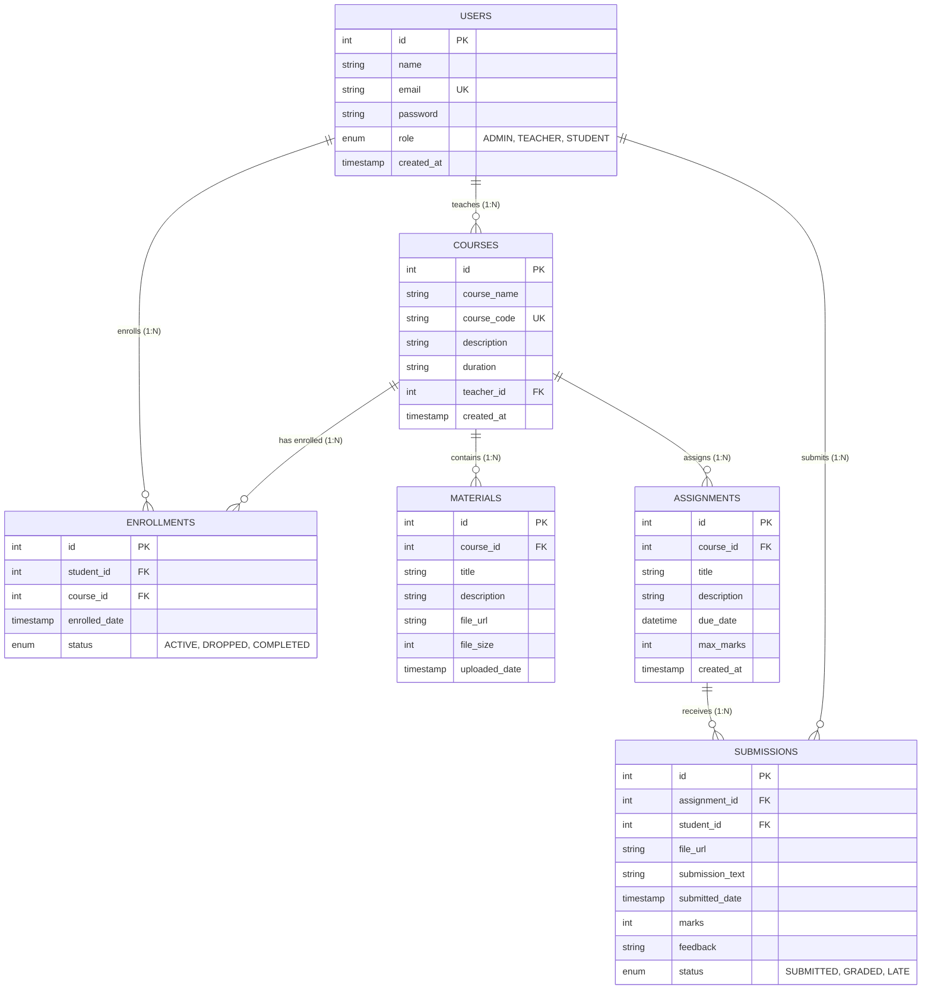

# EduSphere CMS — Course Management System

A full-stack, enterprise-grade **Course Management System (CMS)** built for colleges, universities, and training institutes. It provides unified course administration, enrollment tracking, study material distribution, homework assignments, and grading workflows across **Student**, **Teacher**, and **Admin** portals with relational MySQL integrity and role-based access control.

---

## 🌟 Key Features

### 👨🎓 Student Portal
- **Course Catalog**: Browse all available active courses with teacher assignments and duration.
- **1-Click Enrollment**: Seamlessly enroll or drop courses with duplicate protection.
- **Study Materials**: Access and download lecture notes, PDFs, and slide decks.
- **Assignments**: View upcoming deadlines and submit assignments with file uploads and comments.
- **Grade Book**: Real-time evaluation view displaying scores, max marks, status, and instructor feedback.

### 👨🏫 Teacher Portal
- **Course Management**: Manage assigned courses and review enrolled student rosters.
- **Study Materials**: Upload lecture notes, PDF slides, documents, and reference archives.
- **Assignment Builder**: Create assignments with custom deadlines and maximum scores.
- **Submission Review**: Inspect student submissions, download submitted work, and review notes.
- **Evaluation & Grading**: Enter marks and structured constructive feedback.

### 👨💼 Admin Portal
- **Analytics Dashboard**: High-level KPI metrics (Total Students, Teachers, Courses, Active Enrollments, and Submissions).
- **User Directory**: View, filter, and manage all student, teacher, and administrator accounts.
- **Course Catalog Administration**: Create new courses, assign instructors, and delete courses.
- **Account Provisioning**: Direct creation of faculty and student credentials.

---

## 🏗️ System Architecture & Tech Stack

```
                   EduSphere CMS Architecture
                              │
         ┌────────────────────┴────────────────────┐
         │                                         │
   Client Layer                              Server Layer
(Single Page Application)                (Node.js + Express API)
  - HTML5 & Modern CSS3                    - JWT & Role Authorization
  - Glassmorphism Design                   - RESTful Endpoints
  - Responsive Mobile/Desktop              - Multer File Upload Engine
  - 1-Click Persona Bar                    - Parameterized SQL Queries
                                                   │
                                                   ▼
                                         Relational Database
                                              (MySQL 8.0)
                                      ┌────────────┼────────────┐
                                      ▼            ▼            ▼
                                    Users       Courses    Enrollments
                                      │            │            │
                                      ▼            ▼            ▼
                                 Submissions   Materials   Assignments
```

- **Backend Runtime**: Node.js v20+ / Express.js
- **Database**: MySQL 8.0 (`mysql2/promise` with connection pooling)
- **Security**: `bcryptjs` password hashing, `jsonwebtoken` (JWT) stateless auth, `cors`
- **File Storage**: `multer` disk storage for study materials and submissions
- **Frontend**: Modern Vanilla JS + CSS3 with Glassmorphism, Google Fonts (`Plus Jakarta Sans`), and animated feedback toasts

---

## 🗄️ Database Design & ER Diagram

The database schema is fully normalized into 3NF with cascading foreign keys:



---

## 🚀 Quick Start Guide

### 1. Prerequisites
- **Node.js** (v18 or higher)
- **MySQL 8.0** (or higher)

### 2. Clone the Repository
```bash
git clone https://github.com/saivishal89/course-management-system.git
cd course-management-system
```

### 3. Install Dependencies
```bash
npm install
```

### 4. Configure Environment
Copy `.env.example` to `.env`:
```bash
cp .env.example .env
```
Update your MySQL credentials in `.env`:
```env
DB_HOST=localhost
DB_USER=root
DB_PASSWORD=your_mysql_password
DB_NAME=course_management
DB_PORT=3306
JWT_SECRET=your_jwt_secret_key
```

### 5. Initialize MySQL Database & Sample Seed Data
Run the automated database setup script:
```bash
npm run init-db
```
*(Alternatively, you can import `database/schema.sql` and `database/seed.sql` directly inside MySQL Workbench or phpMyAdmin).*

### 6. Start Application
```bash
npm start
```
Visit **`http://localhost:5000`** in your browser.

> **Zero-Friction Fallback**: If MySQL credentials are not yet set, the server automatically starts with an internal mock relational store pre-seeded with sample data so you can test all features immediately!

---

## 🔑 Pre-Configured Demo Accounts

All demo accounts share the password: **`password123`**

| Role | Name | Email | Password |
|---|---|---|---|
| **Admin** | Admin Director | `admin@cms.edu` | `password123` |
| **Teacher** | Prof. Rahul Sharma | `rahul@cms.edu` | `password123` |
| **Teacher** | Dr. Priya Patel | `priya@cms.edu` | `password123` |
| **Student** | Alice Walker | `alice@student.edu` | `password123` |
| **Student** | Bob Jenkins | `bob@student.edu` | `password123` |

*(You can also click any of the **1-Click Demo Persona** buttons at the top banner in the web interface to switch roles instantly).*

---

## 📡 REST API Reference

| Method | Endpoint | Description | Access |
|---|---|---|---|
| `POST` | `/api/auth/register` | Register new user account | Public |
| `POST` | `/api/auth/login` | Authenticate and obtain JWT token | Public |
| `GET` | `/api/auth/me` | Retrieve profile of authenticated user | Authenticated |
| `GET` | `/api/courses` | List all courses (with enrollment status) | Authenticated |
| `POST` | `/api/courses` | Create new course | Admin, Teacher |
| `DELETE` | `/api/courses/:id` | Remove a course | Admin |
| `POST` | `/api/enrollments` | Enroll student into course | Student |
| `GET` | `/api/enrollments/my-courses` | Get student's enrolled courses | Student |
| `POST` | `/api/materials` | Upload study materials (PDF, DOC, ZIP) | Teacher, Admin |
| `POST` | `/api/assignments` | Create assignment with due date | Teacher, Admin |
| `POST` | `/api/assignments/:id/submit` | Student submits assignment file/text | Student |
| `POST` | `/api/assignments/submissions/:id/grade` | Grade submission & provide feedback | Teacher, Admin |
| `GET` | `/api/admin/stats` | Institutional statistics | Admin |
| `GET` | `/api/admin/users` | List all users with role filter | Admin |

---

## 🚢 Cloud Deployment

### Deploy to Render
This repository includes a `render.yaml` blueprint:
1. Connect this GitHub repository to [Render](https://render.com).
2. Create a new **Web Service** or use the **Blueprint**.
3. Supply `DATABASE_URL` or standard MySQL connection environment variables.
4. Render builds and deploys automatically!

### Deploy via Docker
```bash
docker build -t course-management-system .
docker run -p 5000:5000 --env-file .env course-management-system
```

---

## 🎓 Academic Viva Demonstration Workflow

To present this project in a college viva or evaluation:
1. **Login as Admin**: Show total students, teachers, and courses on the analytics cards. Create a new faculty member.
2. **Login as Teacher (Prof. Rahul)**: Create a new course, upload lecture notes, and create an assignment with a due date.
3. **Login as Student (Alice Walker)**: Browse the newly created course, enroll in 1 click, download the lecture notes, and submit homework.
4. **Login as Teacher**: Open the assignment submissions table, download Alice's submitted work, and award 95/100 marks with remarks.
5. **Login as Student**: Open "Grades & Marks" tab to show the updated marks and remarks.

---

## 📄 License
This project is licensed under the MIT License.
