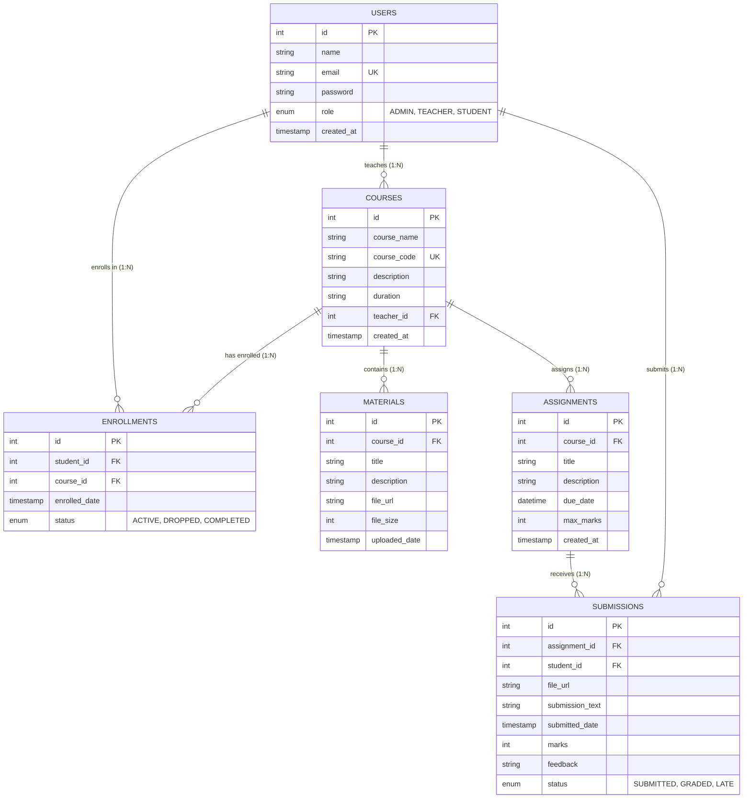

# Course Management System (CMS) - Entity Relationship (ER) Diagram

## Relational Schema Diagram (Mermaid)

---

## Relational Dependencies & Cardinalities
1. **Teacher to Courses**: One Teacher can teach multiple Courses ($1 : N$). A Course is taught by at most one Teacher ($N : 1$).
2. **Student to Courses (Enrollments)**: Many Students enroll in Many Courses ($M : N$), resolved through the associative entity `enrollments`.
3. **Course to Study Materials**: One Course contains multiple study materials ($1 : N$).
4. **Course to Assignments**: One Course contains multiple assignments ($1 : N$).
5. **Student to Assignment Submissions**: Each Student can submit work for each Assignment once ($1 : 1$ per assignment), which carries grades and teacher feedback.
